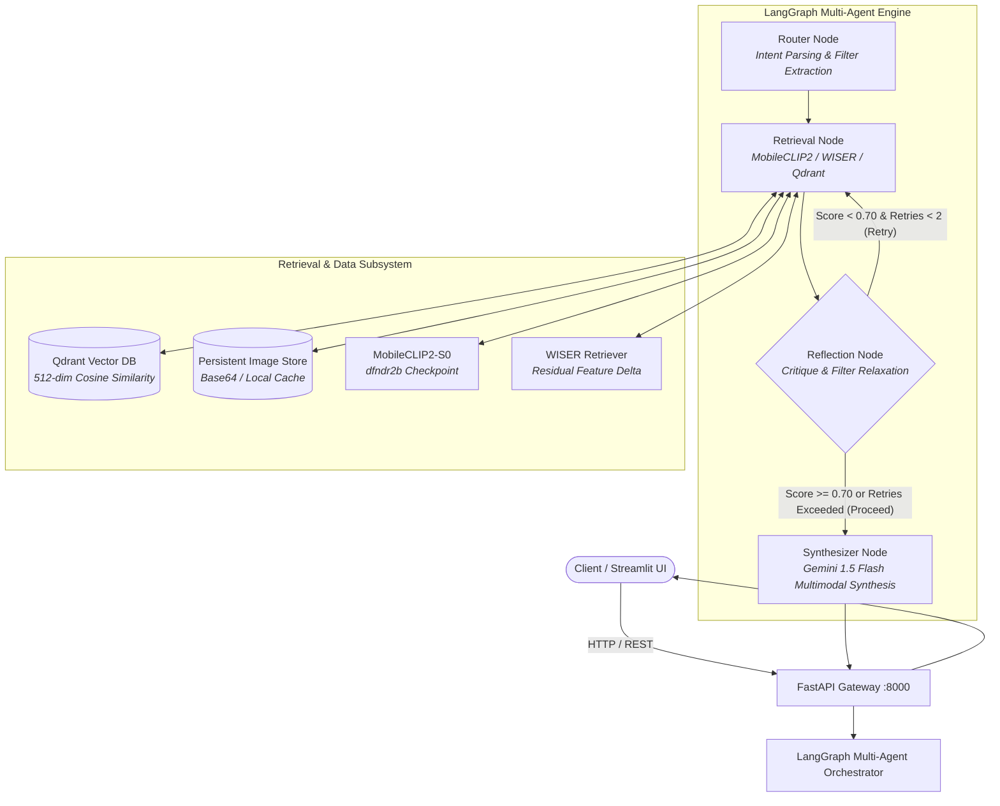

# Clipper: Multimodal Semantic Search & Agentic Intelligence Platform

[](https://www.python.org/downloads/)
[](https://fastapi.tiangolo.com)
[](https://langchain-ai.github.io/langgraph/)
[](https://qdrant.tech/)
[](https://opentelemetry.io)
[](LICENSE)
[](tests/)

**Clipper** is an enterprise-grade Multimodal Semantic Search & Agentic Retrieval-Augmented Generation (RAG) platform. It unifies Apple's **MobileCLIP2-S0**, **WISER** Composed Image Retrieval (CIR), **Qdrant Vector Database**, **LangGraph** multi-agent orchestration with self-reflection loops, and **Google Gemini 1.5 Flash** for multimodal synthesis.

---

## Architecture Overview

Clipper replaces brittle single-turn vector search with an intelligent, self-correcting agent loop. When query ambiguity or strict filter constraints yield poor relevance scores, the reflection engine autonomously relaxes constraints and refines candidate retrieval before synthesizing results.



---

## Key Features

- **MobileCLIP2-S0 Embeddings**: High-throughput 512-dimensional $L_2$-normalized image and text embeddings with automatic hardware acceleration fallback (CUDA $\rightarrow$ Apple Silicon MPS $\rightarrow$ CPU).
- **WISER Composed Image Retrieval (CIR)**: Multimodal query composition enabling natural language modifications on reference images (e.g., *"same dress but in dark blue velvet"*).
- **Qdrant Vector Database**: Embedded and distributed vector search supporting faceted payload filtering (`masterCategory`, `subCategory`, `articleType`, `baseColour`, `gender`, `season`, `usage`).
- **LangGraph Multi-Agent Orchestration**:
  - **Router Agent**: Structured extraction of semantic intent, category taxonomy, and relational filters using Gemini.
  - **Retrieval Agent**: Hybrid faceted vector search combining semantic embeddings with strict metadata filters.
  - **Reflection & Critique Node**: Autonomous relevance verification scoring candidate pools and iteratively relaxing over-constrained filters.
  - **Multimodal Synthesizer**: Natural language explanations justifying product matches against visual and contextual constraints.
- **Enterprise Observability**: End-to-end OpenTelemetry tracing, span tracking across agent nodes, real-time latency percentiles ($p50$, $p90$, $p95$, $p99$), and token telemetry.
- **Interactive Streamlit Web Frontend**: Feature-rich user interface featuring:
  - Text search, image drag-and-drop search, and CIR modification studio.
  - Responsive product catalog grid with high-resolution image previews.
  - Real-time transparent **Agent Inspector** visualizing router extraction, reflection critique loops, and execution latency.
- **Automated IR Evaluation Suite**: Quantitative evaluation harness measuring NDCG@10, Recall@5/10, and MRR across 50 ground-truth multimodal queries.

---

## Empirical Benchmark Results

Benchmarked on 50 curated multimodal queries (text, visual similarity, and composed CIR queries) comparing Clipper's **Multi-Agent Self-Reflective RAG** against standard **Naive 1-Turn $k$-NN Vector Search** (`data/eval_results.json`):

| Evaluation Metric | Naive 1-Turn $k$-NN | Multi-Agent RAG | Relative Improvement |
| :--- | :---: | :---: | :---: |
| **NDCG@10** | 0.5214 | **0.6005** | **+15.17%** |
| **Recall@5** | 0.3713 | **0.4329** | **+16.59%** |
| **Recall@10** | 0.6132 | **0.7113** | **+16.00%** |
| **MRR (Mean Reciprocal Rank)** | 0.6988 | **0.7873** | **+12.66%** |
| **Latency ($p50$)** | 147.5 ms | 536.7 ms | *Includes multi-agent reasoning* |
| **Latency ($p95$)** | 224.2 ms | 801.0 ms | *With reflection & critique loop* |

---

## Repository Structure

```
clipper/
├── checkpoints/             # MobileCLIP2-S0 model checkpoints (dfndr2b)
├── data/
│   ├── eval_queries.json    # 50 curated multimodal evaluation queries
│   ├── eval_results.json    # Quantitative benchmark metrics
│   └── qdrant_storage/      # Local embedded Qdrant vector database files
├── src/
│   ├── agents/              # LangGraph orchestration
│   │   ├── graph.py         # Compiled StateGraph connecting all nodes
│   │   ├── router.py        # Intent & constraint extraction node
│   │   ├── retrieval_agent.py # Vector retrieval node with filter support
│   │   ├── reflection.py    # Self-reflective critique & relaxation node
│   │   ├── synthesizer.py   # Gemini multimodal explanation node
│   │   ├── state.py         # SearchAgentState definitions and reducers
│   │   └── tools.py         # Retrieval tools
│   ├── api/                 # FastAPI REST service
│   │   ├── app.py           # Application lifecycle, CORS, OpenTelemetry
│   │   └── routes.py        # Endpoints (/search/*, /metrics, /health, /ingest)
│   ├── core/                # Core configurations & infrastructure
│   │   ├── config.py        # Pydantic BaseSettings environment validation
│   │   ├── device.py        # Hardware acceleration detection (CUDA/MPS/CPU)
│   │   ├── llm.py           # Gemini ChatModel adapter (Google AI Studio / Vertex)
│   │   └── telemetry.py     # OpenTelemetry tracing and latency metric tracker
│   ├── db/
│   │   └── qdrant.py        # Qdrant client, schema creation, payload indexes
│   ├── evaluation/
│   │   └── evaluator.py     # IR evaluation harness (NDCG, Recall, MRR)
│   ├── frontend/            # Streamlit interactive web application
│   │   ├── app.py           # Streamlit entrypoint
│   │   ├── client.py        # Backend API HTTP client
│   │   └── components/      # UI components (search bar, product grid, inspector)
│   ├── models/              # Vision-Language models & schemas
│   │   ├── embedder.py      # MobileCLIP2-S0 model wrapper & batch inference
│   │   ├── wiser.py         # WISER composed image retrieval retriever
│   │   └── schemas.py       # Pydantic request/response domain models
│   └── pipeline/            # Data ingestion & ETL
│       ├── enrichment.py    # Catalog metadata normalization & text enrichment
│       ├── image_store.py   # Image caching and retrieval store
│       └── ingestion.py     # Ingestion CLI for Hugging Face fashion catalog
├── tests/                   # Test suite (112 unit & integration tests)
├── .env.example             # Environment configuration template
├── pyproject.toml           # Project dependencies & build configuration
└── README.md                # Project documentation
```

---

## Setup & Installation

### 1. Prerequisites

- Python 3.10, 3.11, or 3.12
- Google Gemini API key (via [Google AI Studio](https://aistudio.google.com/) or Google Cloud Vertex AI)

### 2. Environment Setup

Clone the repository and create an isolated virtual environment:

```bash
git clone https://github.com/your-org/clipper.git
cd clipper

python3 -m venv .venv
source .venv/bin/activate
pip install --upgrade pip
pip install -e ".[dev]"
```

### 3. Environment Variables Configuration

Copy `.env.example` to `.env` and configure your API keys and parameters:

```bash
cp .env.example .env
```

Key environment configuration variables:

| Variable | Default Value | Description |
| :--- | :--- | :--- |
| `LLM_PROVIDER` | `google_ai_studio` | Provider: `google_ai_studio` or `vertex_ai`. |
| `GEMINI_API_KEY` | *(Required)* | Google Gemini API key. |
| `GEMINI_MODEL` | `gemini-1.5-flash` | Gemini model variant. |
| `MODEL_NAME` | `MobileCLIP2-S0` | Multimodal embedder architecture. |
| `PRETRAINED_TAG` | `dfndr2b` | Checkpoint tag for MobileCLIP2. |
| `CHECKPOINT_DIR` | `./checkpoints` | Local directory storing model checkpoints. |
| `QDRANT_PATH` | `./data/qdrant_storage` | Local directory for embedded Qdrant vector database. |
| `QDRANT_HOST` | `localhost` | Qdrant server hostname (if using remote server). |
| `QDRANT_PORT` | `6333` | Qdrant server port. |
| `COLLECTION_NAME` | `fashion_catalog` | Name of the Qdrant vector collection. |
| `MIN_CONFIDENCE_SCORE` | `0.70` | Confidence threshold triggering reflection loops. |
| `MAX_REFLECTION_RETRIES`| `2` | Maximum retry attempts for constraint relaxation. |

---

## Data Ingestion

Populate Qdrant with e-commerce products from the Hugging Face fashion catalog (`ashraq/fashion-product-images-small`):

```bash
# Ingest 1,000 items for rapid testing
python -m src.pipeline.ingestion --limit 1000 --batch-size 32

# Ingest full dataset and recreate the collection
python -m src.pipeline.ingestion --recreate --batch-size 64
```

CLI options:
- `--limit`, `-n`: Number of catalog records to ingest (default: all).
- `--batch-size`, `-b`: Batch size for MobileCLIP2 visual embedding and Qdrant batch upserts (default: 32).
- `--recreate`: Drops and rebuilds the Qdrant collection and payload indexes before ingesting.
- `--streaming`: Streams dataset samples directly from Hugging Face instead of downloading the entire split.

---

## Running the Platform

### 1. Launch the FastAPI Backend Service

```bash
uvicorn src.api.app:app --host 0.0.0.0 --port 8000 --reload
```

- API Base URL: `http://localhost:8000`
- Interactive OpenAPI / Swagger Documentation: `http://localhost:8000/docs`
- Health Check: `http://localhost:8000/health`
- Real-Time Telemetry Metrics: `http://localhost:8000/metrics`

### 2. Launch the Streamlit Interactive Web Application

In a separate terminal (with the virtual environment activated):

```bash
streamlit run src.frontend/app.py
```

The web interface will open at `http://localhost:8501`.

---

## API Reference

### Health & Metrics
- `GET /health`: Returns service status, vector database connectivity, model status, and device info.
- `GET /metrics`: Returns real-time latency percentiles ($p50, p90, p95, p99$), request counts, and token telemetry.

### Search Endpoints
- `POST /search/text`: Agentic multimodal search from natural language queries.
  ```json
  {
    "query": "formal summer navy blue shirt for men under $50",
    "limit": 10
  }
  ```
- `POST /search/image`: Visual similarity search using an uploaded image (multipart form data or base64 JSON payload).
- `POST /search/hybrid`: WISER Composed Image Retrieval (reference image + natural language modification prompt).
  ```json
  {
    "reference_image": "<base64_encoded_image>",
    "modification_prompt": "same style but in crimson red",
    "limit": 10
  }
  ```
- `POST /search/knn`: Naive 1-turn baseline vector search (for benchmarking against agentic RAG).
- `POST /ingest`: Trigger catalog ingestion via API (supports background execution).

---

## Running Benchmarks & Evaluation

Execute the automated Information Retrieval (IR) benchmark harness to compute NDCG@10, Recall@K, and MRR metrics:

```bash
# Run evaluation across the 50 ground-truth queries in direct mode
python -m src.evaluation.evaluator --queries data/eval_queries.json --mode direct

# Run evaluation against a running FastAPI instance
python -m src.evaluation.evaluator --queries data/eval_queries.json --mode api --api-url http://localhost:8000
```

---

## Running Tests

The test suite validates embedders, WISER CIR, Qdrant payload filters, LangGraph multi-agent cycles, FastAPI routes, and Streamlit components:

```bash
# Run the full test suite
pytest tests/

# Run with verbose output and duration reporting
pytest tests/ -v --durations=10
```

---

## License

This project is licensed under the GNU Affero General Public License v3.0 (AGPLv3). See the [LICENSE](LICENSE) file for details.
